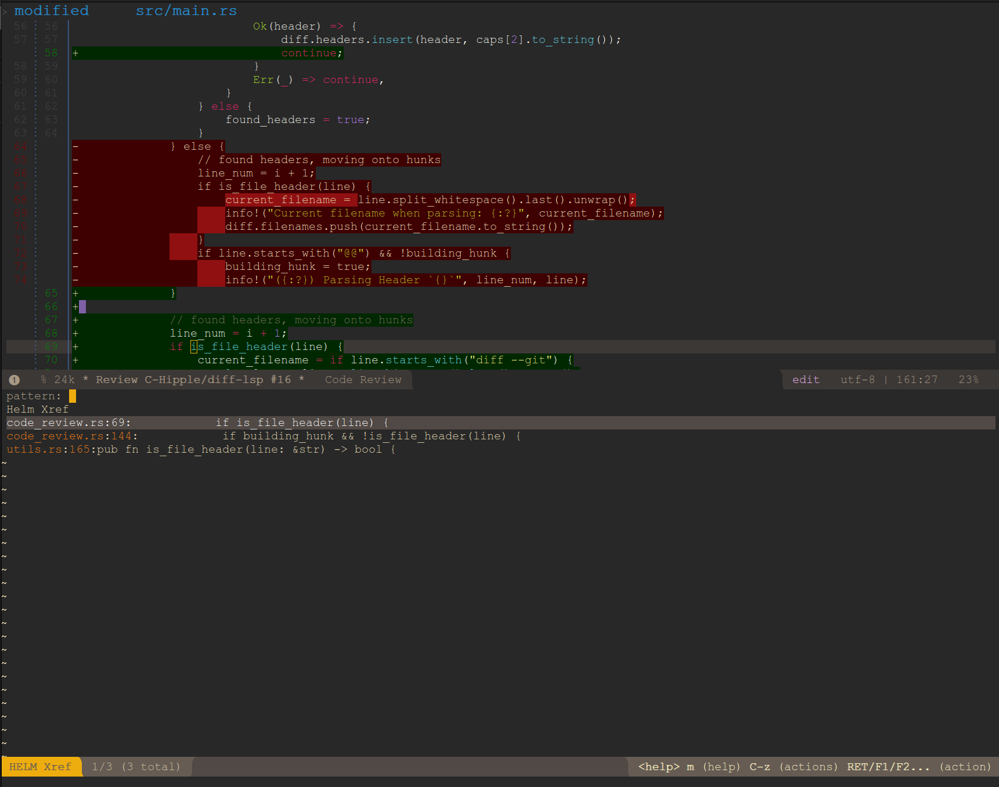

# diff-lsp

Middleware Language server parsing diffs

Acts as a server from your editor's point-of-view, and as a client to your "backend" LSPs (such as rust-analyzer or gopls).


Editor -> diff-lsp -> [rust-analyzer, gopls, pylsp, etc]

Allows your editor to use the following lsp capabilities in diffs
- Hover
- Jump Definition
- Find References
- Jump to type definition
- Breadcrumb mode.



Finding the references for a code-review by calling out to rust-analyzer.

`diff-lsp` mostly follows the standard language-server protocol, so you can configure your clients to use this LSP server.  However, diff-lsp typically works on ephemeral buffers (such as git-status or code reviews), and LSP is a file-based protocol.  This means that for usage in these buffers, some client modifications are required.


See [Documentation](https://diff-lsp.readthedocs.io/en/latest/) for full docs

## Quickstart


### Emacs

See [diff-lsp.el](https://www.github.com/C-Hipple/diff-lsp.el) for configuring & running with emacs.

diff-lsp.el can manage diff-lsp for the following modes:
* magit status 
* [code-review-server emacs client](https://www.github.com/C-Hipple/code-review-server)
* [code-review](https://www.github.com/C-Hipple/code-review)

## Diff locations (staying in the review)

For **Find References**, **Jump Definition** and **Jump to type definition**, backend LSPs return locations in real source files.  When a returned location falls on a line that is visible in the diff (an added or unmodified line of a hunk for that file), diff-lsp also returns the matching location *inside the diff buffer* (the diff buffer's own URI, the diff line, and the column shifted past the `+`/`-`/space prefix — 2 columns for code-review-server buffers).  This lets "find references" during a code review jump around the review instead of opening files.

Configure it with `initializationOptions` from your editor:

```json
{ "diffLocations": "both" }
```

| value    | behaviour |
|----------|-----------|
| `both` (default) | Diff locations first, then all source locations (deduplicated). |
| `prefer` | Each source location visible in the diff is replaced by its diff location; others are kept. |
| `off`    | Backend results are returned unchanged. |

Locations outside the project root (std lib, dependencies) and lines that are not shown in the diff (including removed lines) are returned as plain source locations.

## Backend startup

Backend LSPs are started for the languages found in the initialization file. If a later diff contains a new language, its backend is started on demand when the buffer is opened; no restart needed.

If a backend binary is missing (e.g. `pylsp` isn't installed) or fails to initialize, diff-lsp keeps running without it and shows a warning such as `pylsp not found; Python features disabled`. It doesn't retry that backend for the rest of the session.

Hover, definition, type definition and references return an empty result (not an error) on lines that don't map to source, like headers, comments and blank lines.

## Initialization file

diff-lsp reads its context (`Root:`, optional `Worktree:`, and the diff) from an initialization file. It looks for one in this order:

1. A path on the command line: `diff-lsp --init <path>`, `--init=<path>`, or a bare `diff-lsp <path>` (`--init` wins if both are given)
2. The `DIFF_LSP_INIT_FILE` environment variable
3. The newest `diff_lsp_*` file in the system temp dir (`$TMPDIR`, as used by Emacs on macOS) or `/tmp`

## Worktree Integration

`diff-lsp` supports an optional `Worktree:` parameter in its initialization tempfile. If provided, `diff-lsp` will attempt to start backend LSP clients in the specified subfolder. This is useful for monorepos or when working in a specific part of a large project. If the worktree subfolder does not exist, it gracefully falls back to the project root.
